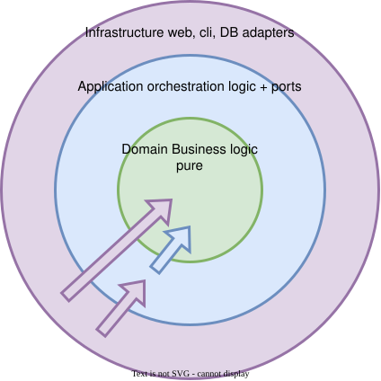
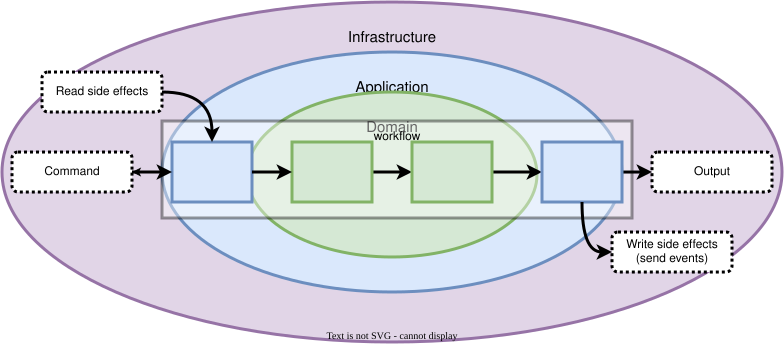

# Rust DDD / Hexagonal Application Template

A workspace skeleton for building complex applications in Rust where the domain
rules live in the type system and I/O is pushed to the edges.

The design follows these ideas:

- **Domain-Driven Design** — the domain speaks the language of the business.
- **Onion / Hexagonal architecture** — dependencies point inward only.
- **Type-Driven Development (TyDD)** — make illegal states unrepresentable.
- **Functional core, imperative shell** — pure domain decisions, orchestrated I/O.
- **AI-friendly** — explicit types, clear boundaries, compiler-checked refactors.

This template ships the **structure and the rules**, not a domain model. The
`Payment` / `Money` snippets you will meet in the docs are illustrative examples
only; they are intentionally absent from the code.

## Onion / Hexagonal architecture

<p align="center">
  
</p>

<p align="center"><em>Dependencies point inward. The outer layers know the inner ones; never the reverse.</em></p>

The dependency rule is what makes the architecture work:

- **Domain** — the business, expressed as types and pure functions. No I/O, no
  framework, no clock, no network. This is the most valuable and most stable
  layer.
- **Application** — orchestrates the domain and owns all I/O. Declares the
  **ports** the outside world must implement.
- **Infrastructure** — **driven adapters** that implement the ports
  (repository, unit of work, event bus, external services).
- **CLI / HTTP / worker** — **driving adapters** that call the application.

The arrow points **inward only**: `domain ← application ← infrastructure ← cli`.
That direction is enforced by the crate graph, so a violation is a compile
error, not a review comment.

## Workflow: pure decision + orchestration

<p align="center">
  
</p>

<p align="center"><em>A command enters the application workflow: it reads state through an adapter, calls the pure domain workflow, writes the new state and emits events — all the I/O staying at the edges.</em></p>

Every business operation — one use case — is split in two:

| | Domain workflow (pure) | Application workflow (I/O) |
|---|---|---|
| Signature | `(State, Command) -> Result<(State, Events), DomainError>` | `Command -> Result<Output, Error>` |
| Contains | the **decision**: invariants, transitions, events | the **orchestration**: load, call, persist, publish |
| Depends on | nothing outside the domain | ports only (injected as arguments) |
| Tested with | plain values, no fakes | fakes/mocks of the ports |

An application workflow is always the same shape:

1. **Load** the state through a port (repository).
2. **Run** the pure domain workflow to get the new state and the domain events.
3. **Persist** the new state and publish the events in the **same transaction**
   (unit of work / outbox) — so events are never lost.

The domain decides *what* should happen; the application makes it happen. That is
why the domain can be tested without a database, and why swapping MySQL for
in-memory, or HTTP for a CLI, touches only the adapters.

See the [`add-workflow`](.agents/skills/add-workflow/SKILL.md) skill for the full
recipe.

## Layout

```
crates/
  domain/          pure types, invariants, domain workflows (no I/O)   — empty
  application/     application workflows + ports (owns all I/O)      — empty
  infrastructure/  adapters implementing the ports                     — empty
  cli/             driving adapter / composition root (`app`)          — empty
```

Each crate's `lib.rs` (and `application/src/ports.rs`) documents exactly what
belongs there and how to start.

See [`AGENTS.md`](AGENTS.md) for the full architecture contract. **Read it
before contributing.** Detailed, task-specific playbooks live in
[`.agents/skills/`](.agents/skills) and are loaded on demand by Pi (e.g.
`/skill:add-workflow`).

## Quick start

```bash
make check                 # fmt + clippy (-D warnings) + tests
cargo test --workspace
cargo run -p app-cli       # the composition root
```

If you use Nix, `direnv allow` (or `nix develop`) provides the toolchain. A
`rust-toolchain.toml` is provided for rustup users.

To start a project from this template, rename the crate packages and the binary
first — see the [`rename-app`](.agents/skills/rename-app/SKILL.md) skill.
